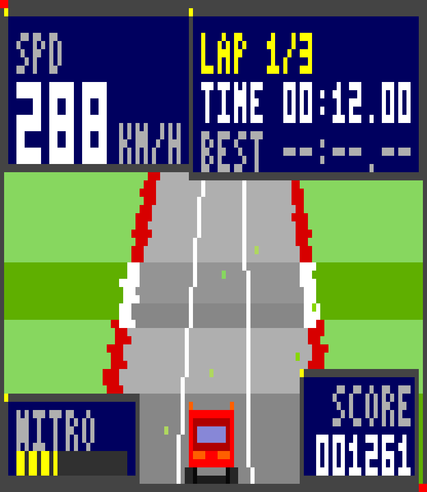
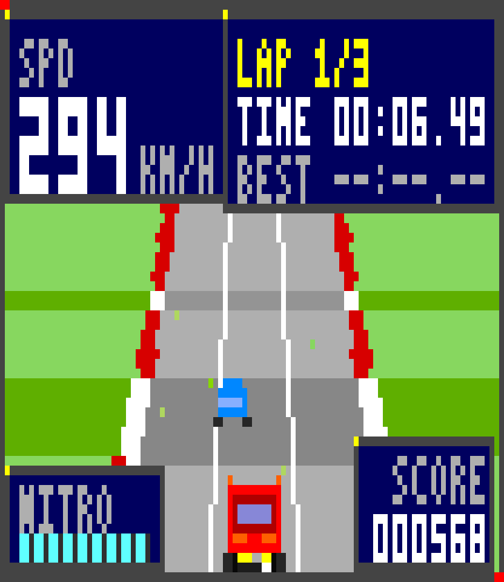
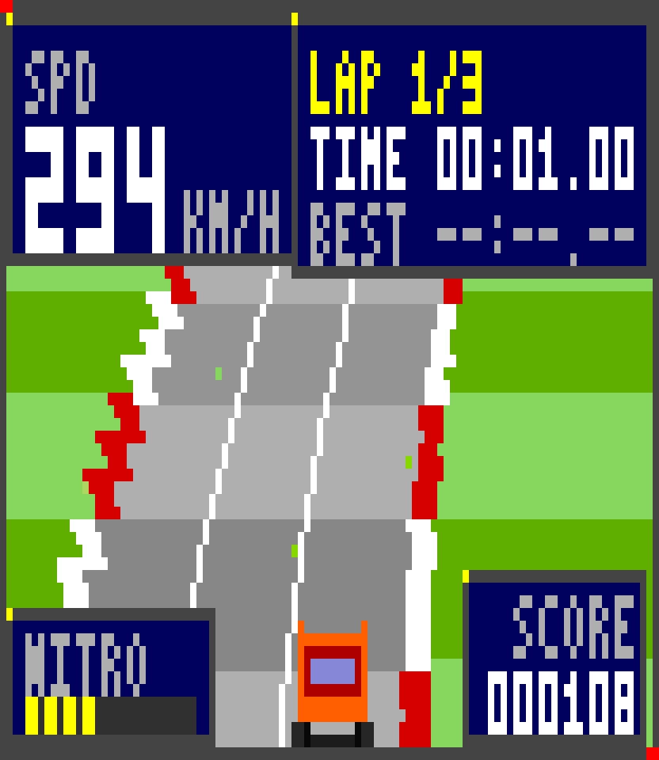
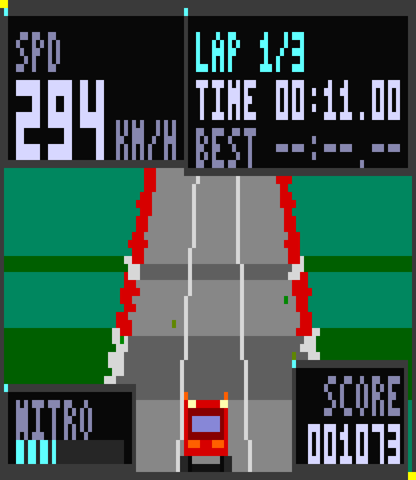
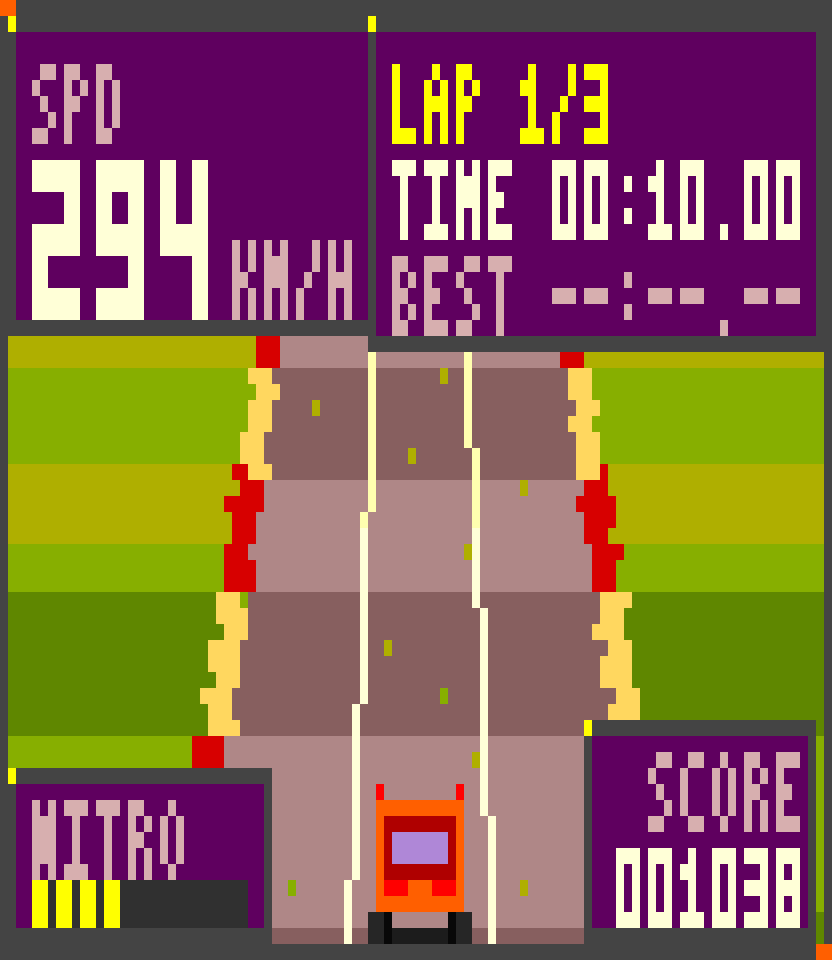
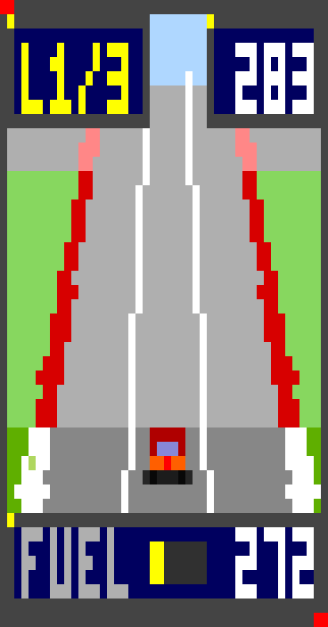

# Step Code Rally 🏁

> [中文说明](README.md) · English version

A pixel-art **2.5D racing game** that lives inside StepCode as an extension — a 45° top-down racer in a floating panel on the right edge of your terminal, running while you write code.

It is **off by default**. Run `/rally on` and a racing panel appears on the right; it is non-capturing, so you keep typing in the editor while the car drives itself — and every coding event (tool calls, edits, streamed tokens, your prompts) feeds it nitro. `/rally` takes the wheel fullscreen.

```
 ┌────────────────────────────────────┬───────────────┐
 │ > refactor the parser              │ STEP CODE RALLY│
 │                                    │ ┌───────────┐ │
 │  ✓ read  parser.ts                 │ │ L1/3  283 │ │
 │  ✓ edit  parser.ts                 │ │  ╱‾‾road‾‾╲ │ │
 │  ⠋ thinking...                     │ │  ╲__car__╱ │ │
 │                                    │ │ FUEL ███░  │ │
 │ > _                                │ └───────────┘ │
 └────────────────────────────────────┴───────────────┘
        your editor keeps focus              /rally off
```
## What it is

- **Opt-in floating panel.** `/rally on` drops a racing panel on the right edge of the terminal. It does not steal keyboard focus, so the editor stays yours — the race just runs beside your code. `/rally off` closes it.
- **45° top-down pixel art.** The camera looks down at the track at 45°, so the whole frame is road and scenery — the RC Pro-Am / Micro Machines angle. Curves, crests and dips come from a real segment projection, rasterised into a palette framebuffer and drawn with Unicode half-blocks so every pixel stays square.
- **Code speed is car speed.** In the panel the car's speed *is* the model's token generation rate: 60 tok/s is full speed, a fast stream makes a fast car, and a stalled stream eases it down to an idle creep — so it doubles as a live throughput meter. Tool calls and your prompts add nitro and score on top.
- **Driver assist.** A traction correction blends a corrective steer in past the shoulder margin — it never fights your steering, but it will not let the car stay out on the grass, whether you are driving or the autopilot is. There is also an adaptive cruise that matches the speed of the car in front instead of rear-ending it, and crashes can no longer kick the car off the road.
- **One race, two views.** `/rally` takes the wheel fullscreen (the panel hides itself and comes back after); leaving hands the car back to the autopilot.
- **Session persistence.** Lap times, best lap, score, distance and position are saved into the session (like the built-in Snake example), so `/new` or `/resume` picks the race back up.
- **Three themes.** `day`, `sunset`, `night`.

## Screenshots

Rendered headlessly by `npm run frames` (one PNG pixel per art pixel):

| | |
|---|---|
|  |  |
|  |  |
|  |  |
## Install

The extension has **no runtime dependencies** — copy the `src/` directory into a StepCode extensions folder.

Global (all projects):

```bash
# Windows
xcopy /E /I src "%USERPROFILE%\.stepcode\agent\extensions\step-rally"

# macOS / Linux
cp -r src ~/.stepcode/agent/extensions/step-rally
```

Project-local (only for this repo):

```bash
mkdir -p .stepcode/extensions
cp -r src .stepcode/extensions/step-rally
```

Then start `step` (or run `/reload` if it is already running). Extensions in auto-discovered locations are hot-reloadable.

Quick one-off test without installing:

```bash
step -e ./src/index.ts
```

## Commands

| Command | What it does |
|---|---|
| `/rally on` | Open the floating race panel on the right (default: off) |
| `/rally off` | Close the panel |
| `/rally` | Take the wheel — fullscreen race |
| `/rally theme day\|sunset\|night` | Switch palette |
| `/rally size 12-34` | Panel height in rows (default 22) |
| `/rally stats` | Lap, speed, nitro, score, overtakes, crashes, best lap |
| `/rally reset` | Restart the race |
| `/rally help` | Controls and command list |

The panel is a spectator view: it never captures the keyboard, so you keep
coding while it drives itself. The game loop only runs while the panel or the
fullscreen race is on screen.

In RPC mode there are no overlays, so `/rally on` streams the panel as plain
widget lines instead — handy for IDE clients that embed the agent.

## Controls (fullscreen)

| Key | Action |
|---|---|
| `←` `→` / `A` `D` | Steer |
| `↑` / `W` | Accelerate |
| `↓` / `S` | Brake |
| `Space` | Nitro (burns the fuel bar) |
| `P` | Pause |
| `R` | Restart |
| `Esc` / `Q` | Save and exit back to coding |

## How the code fuel works

| Session event | Effect |
|---|---|
| Agent turn starts | +nitro |
| Tool call starts | +nitro |
| Tool result (success) | +score, +nitro, speed kick |
| Tool result (error) | nitro burn cancelled, car shaken |
| Streamed tokens (text/thinking/tool-call deltas) | **sets the car's speed** (60 tok/s = full speed) |
| You send a prompt | bigger boost |

Mapping: `tokenRate / 60` clamped to 0..1 is the share of full speed allowed, with a 10% idle floor (~32 km/h) so the car creeps rather than stopping when nothing is being generated. The rate is measured over a 250ms sliding window with half-life smoothing, so it does not jitter per chunk. Nitro multiplies 1.34x on top of the token ceiling.

Manual fullscreen driving is not limited by the token rate (otherwise the game would barely move while the agent is idle) — it keeps the full arcade speed range.

Measured curve from one real agent turn (the model thinks first, then streams; `step --mode rpc`):

| t | speed | state |
|---|---|---|
| 5s | 32 km/h | thinking, no tokens — idle creep |
| 15s | 156 km/h | stream ramps up, smooth acceleration |
| 25s | 301 km/h | full stream rate |
| 30s | 274 km/h | stream finished, easing down |

## Development

```bash
npm install
npm run typecheck   # tsc --noEmit
npm test            # 38 checks: physics, laps, persistence, panel/game rendering, assists, lane markings, token speed
npm run frames      # render QA frames to frames/*.png
npm run sim         # second-by-second simulation trace (tuning)
npm run sim:offroad # off-road share + crash count over several random tracks
npm run sim:curve   # throw the car at the tightest curve flat out
npm run sim:recover # shove the car onto the grass and watch it come back
npm run sim:manual  # wheel pinned full-lock: does the assist hold the road?
```


Measured over six randomly generated tracks, 60 seconds each:

| | before | after |
|---|---|---|
| time spent off the road | up to 1.5% | **0.0%** |
| crashes per minute | 6–10 | **0–2** |
| top speed | 350 km/h | 420 km/h |
| worst lateral position with the wheel pinned full-lock for 10s | — | **0.92** (road edge 1.00) |

Verified against the installed `step` binary (0.1.6): the extension auto-loads from
`~/.stepcode/agent/extensions/step-rally/`, stays dormant until `/rally on`, `/rally stats`
reports a live race, and a real agent turn (model prompt + one tool call) registered as a
code boost.

### Layout

```
src/
  index.ts     extension entry: commands, events, persistence, panel wiring
  runtime.ts   one shared world + game loop + frame rendering
  game.ts      car physics, traffic, laps, scoring, nitro, autopilot
  scene.ts     track/HUD composition into the framebuffer
  engine.ts    pseudo-3D projection and segment rasteriser
  track.ts     procedural track builder (curves, hills, scenery)
  sprites.ts   pixel sprite definitions and baking
  palette.ts   256-color themes + fog lookup tables
  font.ts      3×5 pixel font
  fb.ts        pixel framebuffer (trapezoids, sprite blits)
  blit.ts      framebuffer -> ANSI half-block lines
  panel.ts     floating side-panel component
  play.ts      fullscreen game component
scripts/
  selftest.ts        headless checks (no terminal needed)
  render-frames.ts  PNG frame dumps for visual QA
  debug-sim.ts      second-by-second simulation trace
  debug-offroad.ts  off-road share + crash count over several tracks
  debug-curve.ts    hardest-curve stress test
  debug-recover.ts  shove the car onto the grass and watch it come back
  debug-manual.ts   wheel pinned full-lock: does the assist hold the road?
```

`scripts/render-frames.ts --crop <frame> <x> <y> <w> <h>` zooms into a region, which is how the HUD and car sprites were checked.

### Rendering notes

- Each terminal cell carries two pixels via `▀` (foreground = upper pixel, background = lower pixel), which doubles vertical resolution and keeps pixels square.
- The camera looks down at 45° (`CAMERA_ANGLE` in `track.ts`). The projection rotates world points into camera space, so `focal` (the frame height) fixes the framing: the same number of segments is in shot at any resolution, and the player's car lands on the bottom row.
- Because the horizon sits above the frame, the whole frame is track; the sky/sun/mountain block in `scene.ts` only draws when the camera is tilted back far enough for the horizon to be visible, so dialling `CAMERA_ANGLE` down brings the sky back.
- Fog is a precomputed palette lookup (6 banded levels) rather than per-pixel blending, so distant segments posterise like hand-placed pixel art.
- Sprite scaling is nearest-neighbour, so art stays chunky at every distance.

## Requirements

- StepCode (the extension API it ships with)
- A terminal with 256-color support; Kitty keyboard protocol gives smooth key press/release handling in the fullscreen game (elsewhere a tapped key auto-releases after ~170ms, which still drives fine).


## License

[MIT](LICENSE) © 2026 wosledon
