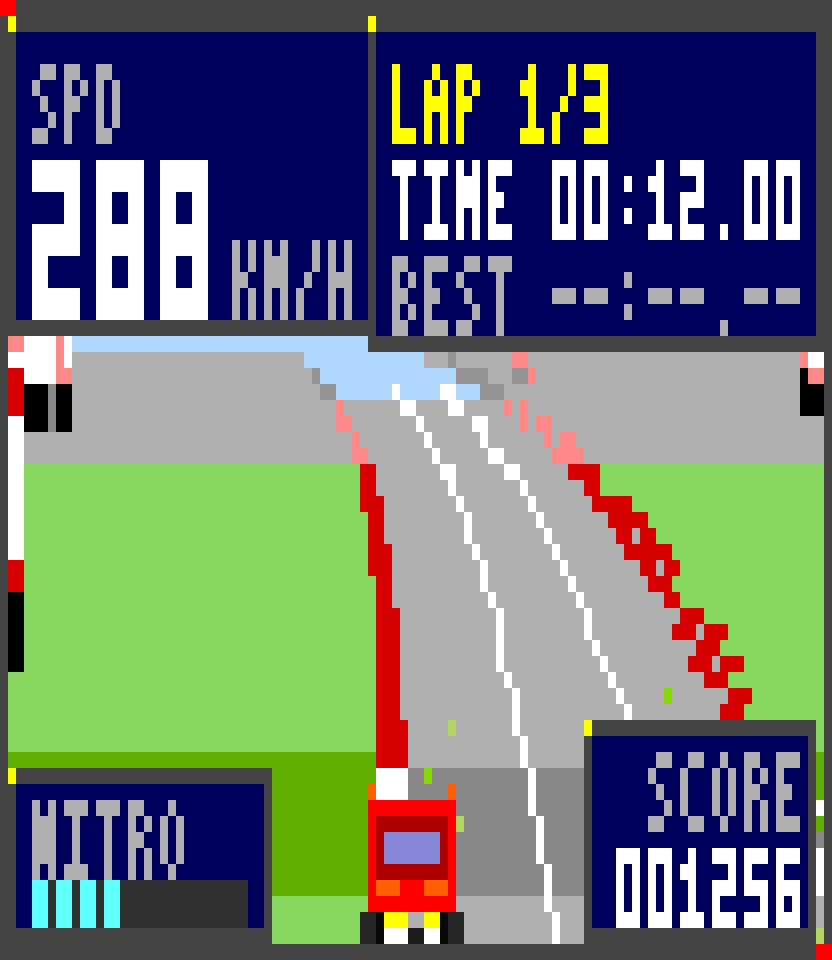
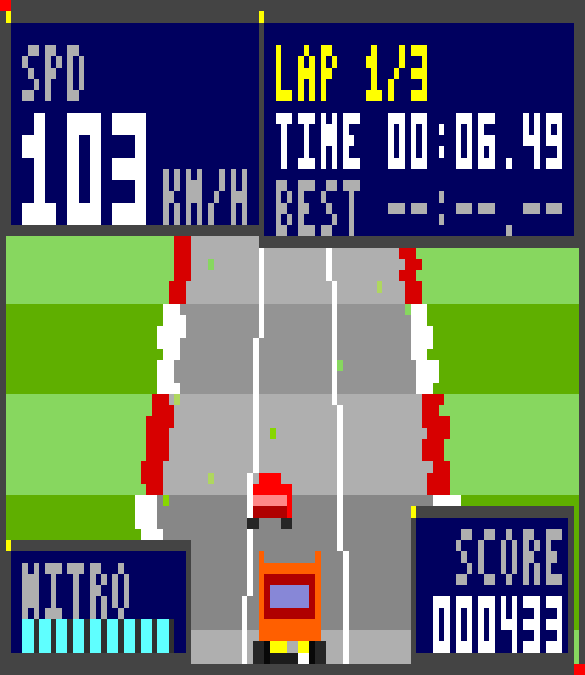
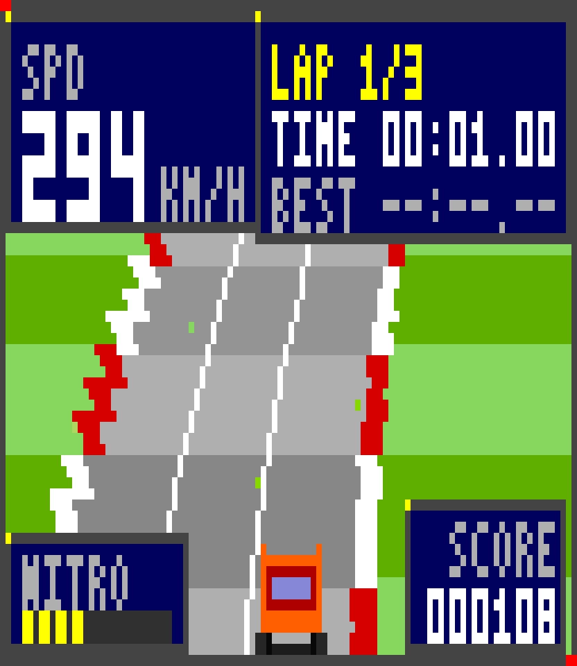
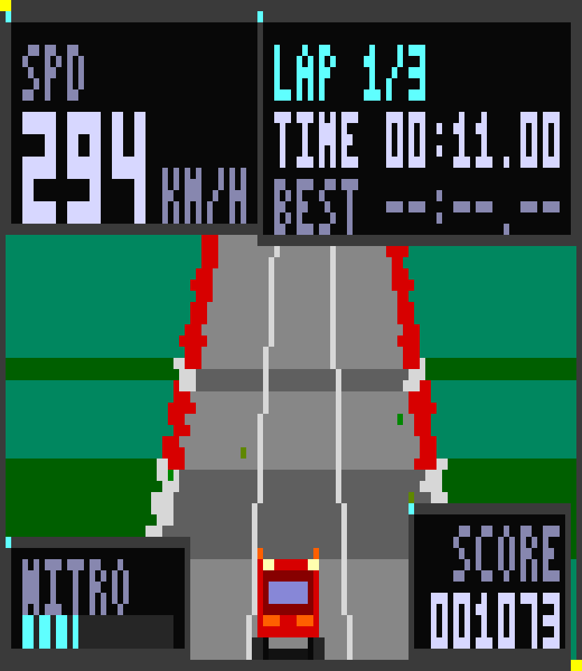
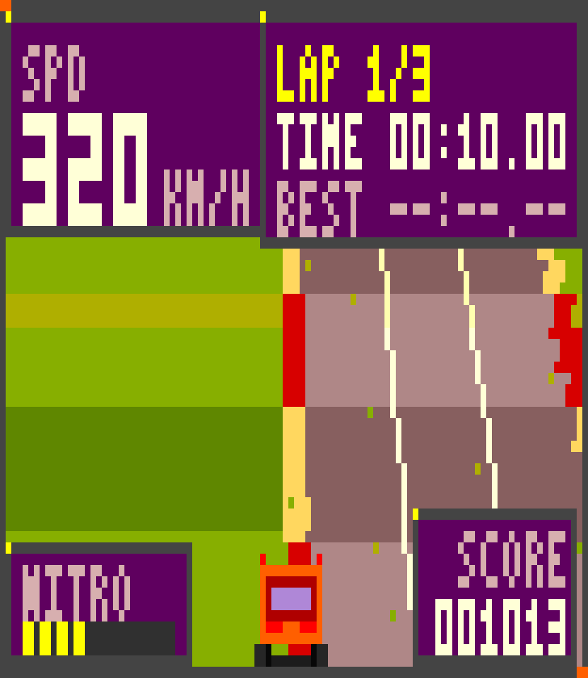
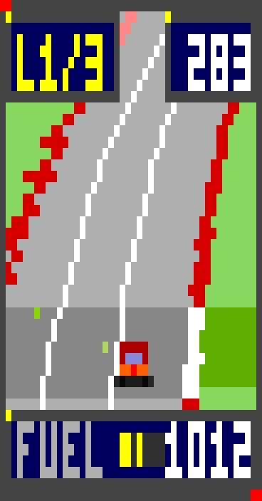

# Step Code Rally 🏁

> [English](README.en.md) · 中文说明

一个像素风 **2.5D 赛车游戏**，以 StepCode 扩展的形式存在——45° 俯视角赛车，悬浮在终端右侧，你写代码它就在旁边跑。

**默认关闭**。运行 `/rally on`，右侧会出现一个赛车面板；它不抢占键盘焦点，你可以继续在编辑器里打字，车自己开——而每一次编码事件（工具调用、编辑、流式 token、你发的 prompt）都会给它加氮气。`/rally` 则接管方向盘全屏驾驶。

```
 ┌────────────────────────────────────┬───────────────┐
 │ > refactor the parser              │ STEP CODE RALLY│
 │                                    │ ┌───────────┐ │
 │  ✓ read  parser.ts                 │ │ L1/3  283 │ │
 │  ✓ edit  parser.ts                 │ │  ╱‾‾road‾‾╲ │ │
 │  ⠋ thinking...                     │ │  ╲__car__╱ │ │
 │                                    │ │ FUEL ███░  │ │
 │ > _                                │ └───────────┘ │
 └────────────────────────────────────┴───────────────┘
        编辑器始终是你的焦点              /rally off
```

## 这是什么

- **按需开启的悬浮面板。** `/rally on` 在终端右边缘放下一个赛车面板，不抢键盘焦点——编辑器还是你的，比赛就在代码旁边跑。`/rally off` 收起。
- **45° 俯视像素风。** 相机以 45° 俯视赛道，整个画面都是路面和景物——RC Pro-Am / Micro Machines 那个角度。弯道、坡起、俯冲来自真实的分段投影，栅格化进 256 色调色板帧缓冲，用 Unicode 半块字符绘制，所以每个像素都是方的。
- **代码就是燃料。** 面板开着的时候，工具调用、流式 token 和你发的 prompt 都会加氮气和分数——它同时是一个"当前有多少活正在干"的仪表。
- **驾驶辅助。** 牵引修正会在越过路肩后把回正转向混入你的输入——它从不和你抢方向，但也不会让车一直留在草地上，无论开车的是你还是自动驾驶。另有自适应巡航，会跟着前车速度走而不是追尾；撞车也不再会把车踢出赛道。
- **一场比赛，两个视角。** `/rally` 全屏接管方向盘（面板会自动藏起来，退出后回来）；离开时车交回自动驾驶。
- **会话持久化。** 圈速、最快圈、分数、里程和位置都存进会话（和内置的贪吃蛇示例一样），所以 `/new` 或 `/resume` 之后比赛还能接着跑。
- **三套主题。** `day`、`sunset`、`night`。

## 截图

由 `npm run frames` 无头渲染（每个 PNG 像素对应一个美术像素）：

| | |
|---|---|
|  |  |
|  |  |
|  |  |

## 安装

扩展**没有运行时依赖**——把 `src/` 目录拷进 StepCode 的扩展文件夹即可。

全局（所有项目生效）：

```bash
# Windows
xcopy /E /I src "%USERPROFILE%\.stepcode\agent\extensions\step-rally"

# macOS / Linux
cp -r src ~/.stepcode/agent/extensions/step-rally
```

仅当前仓库：

```bash
mkdir -p .stepcode/extensions
cp -r src .stepcode/extensions/step-rally
```

然后启动 `step`（如果已经在运行就 `/reload`）。自动发现目录下的扩展支持热重载。

不安装、快速试一把：

```bash
step -e ./src/index.ts
```

## 命令

| 命令 | 作用 |
|---|---|
| `/rally on` | 打开右侧悬浮赛车面板（默认关闭） |
| `/rally off` | 关闭面板 |
| `/rally` | 全屏驾驶 |
| `/rally theme day\|sunset\|night` | 切换主题 |
| `/rally size 12-34` | 面板高度（行，默认 22） |
| `/rally stats` | 圈数、速度、氮气、分数、超车、撞车、最快圈 |
| `/rally reset` | 重新开始比赛 |
| `/rally help` | 操作说明和命令列表 |

面板是观战视角：它从不抢占键盘，所以你可以一边写代码一边看它自己开。游戏循环只在面板或全屏比赛可见时运行。

RPC 模式下没有浮层，`/rally on` 会改为把面板作为普通 widget 行输出——方便内嵌 agent 的 IDE 客户端。

## 操作（全屏）

| 按键 | 作用 |
|---|---|
| `←` `→` / `A` `D` | 转向 |
| `↑` / `W` | 油门 |
| `↓` / `S` | 刹车 |
| `空格` | 氮气（消耗燃料条） |
| `P` | 暂停 |
| `R` | 重新开始 |
| `Esc` / `Q` | 保存并退出，回去写代码 |

## 代码燃料怎么算

| 会话事件 | 效果 |
|---|---|
| agent 回合开始 | +氮气 |
| 工具调用开始 | +氮气 |
| 工具结果（成功） | +分数、+氮气、提速 |
| 工具结果（报错） | 取消氮气喷射，车身抖动 |
| 流式 token（节流） | 少量氮气 |
| 你发送 prompt | 大幅加成 |

超车、干净过弯和领跑也会回填燃料条——报错则烧掉这次喷射。

## 开发

```bash
npm install
npm run typecheck   # tsc --noEmit
npm test            # 34 项检查：物理、圈数、持久化、面板/游戏渲染、辅助、车道线
npm run frames      # 渲染 QA 帧到 frames/*.png
npm run sim         # 逐秒仿真轨迹（调参用）
npm run sim:offroad # 多条随机赛道的出界占比与撞车次数
npm run sim:curve   # 把车全油门扔进最急的弯
npm run sim:recover # 把车推到草地上，看它自己回来
npm run sim:manual  # 方向盘打满：辅助守不守得住路面？
```

在 6 条随机生成的赛道上各跑 60 秒的实测：

| 指标 | 修复前 | 现在 |
|---|---|---|
| 出界时间占比 | 最高 1.5% | **0.0%** |
| 每分钟撞车次数 | 6–10 | **0–2** |
| 极速 | 350 km/h | 420 km/h |
| 方向盘打满 10 秒的最大横向位置 | — | **0.92**（路沿 1.00） |

已用安装的 `step` 二进制（0.1.6）验证：扩展从
`~/.stepcode/agent/extensions/step-rally/` 自动加载，`/rally on` 之前完全静默，
`/rally stats` 报告实时比赛，一次真实 agent 回合（模型 prompt + 1 次工具调用）
被正确记为一次代码加成。

### 目录结构

```
src/
  index.ts     扩展入口：命令、事件、持久化、面板接线
  runtime.ts   唯一共享的世界 + 游戏循环 + 帧渲染
  game.ts      车辆物理、车流、圈数、计分、氮气、自动驾驶
  scene.ts     赛道/HUD 合成进帧缓冲
  engine.ts    伪 3D 投影与分段栅格化
  track.ts     程序化赛道生成（弯道、坡道、景物）
  sprites.ts   像素精灵定义与烘焙
  palette.ts   256 色主题 + 雾查找表
  font.ts      3×5 像素字体
  fb.ts        像素帧缓冲（梯形、精灵 blit）
  blit.ts      帧缓冲 -> ANSI 半块字符行
  panel.ts     右侧悬浮面板组件
  play.ts      全屏游戏组件
scripts/
  selftest.ts       无头检查（不需要终端）
  render-frames.ts  PNG 帧导出，用于视觉 QA
  debug-sim.ts      逐秒仿真轨迹
  debug-offroad.ts  多条赛道的出界占比与撞车次数
  debug-curve.ts    最急弯道压力测试
  debug-recover.ts  把车推到草地上，看它自己回来
  debug-manual.ts   方向盘打满：辅助守不守得住路面？
```

`scripts/render-frames.ts --crop <frame> <x> <y> <w> <h>` 可以放大某个区域，HUD 和车身精灵就是这样检查的。

### 渲染要点

- 每个终端单元格用 `▀` 承载两个像素（前景色=上像素，背景色=下像素），垂直分辨率翻倍且像素保持方形。
- 相机以 45° 俯视（`track.ts` 里的 `CAMERA_ANGLE`）。投影把世界点旋转进相机空间，因此 `focal`（帧高）决定取景：任何分辨率下入镜的路段数相同，且玩家的车正好落在最底行。
- 因为地平线在画面之上，整个画面都是赛道；`scene.ts` 里的天空/太阳/远山块只在相机后仰到地平线可见时才绘制，所以把 `CAMERA_ANGLE` 调小就能把天空找回来。
- 雾是预计算的调色板查找（6 个色阶），不是逐像素混合，所以远景像手工放置的像素画一样分层色块化。
- 精灵缩放是最近邻，任何距离都保持粗颗粒像素感。

## 环境要求

- StepCode（及其自带的扩展 API）
- 支持 256 色的终端；全屏游戏中 Kitty 键盘协议带来平滑的按下/释放处理（其他终端上点按会在约 170ms 后自动释放，开起来一样顺手）。

## 许可证

[MIT](LICENSE) © 2026 wosledon
